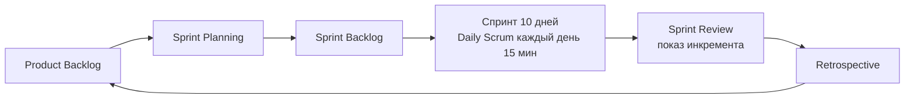

# Задача 19: Трекер багов для небольшой студии

**Студент:** Ленец Е.

**Постановка задачи:**

> Сама студия плохо понимает разницу Scrum vs Kanban. Сделайте сравнительную модель: один и тот же бэклог из 12 задач — как выглядит в Scrum-спринте и как на Kanban-доске. XP: TDD, Collective Ownership, Small Releases.

Файлы в репозитории:

| Файл | Что внутри |
|------|------------|
| `README.md` | постановка и решение (Scrum, Kanban, сравнение, XP) |
| `board.md` | Kanban-доска: колонки, WIP-лимиты, срез на 6-й день, узкие места |
| `examples/backlog.csv` | общий бэклог из 12 задач (его можно открыть в Excel) |
| `examples/burndown.md` | burndown-таблица первого спринта |
| `examples/retro.md` | чек-лист ретроспективы и что решили на ретро |

---

## Решение

### 0. Исходные данные

**Продукт.** Студия из 5 человек делает мобильные игры. Баги сейчас записывают в общий чат Telegram и в Google-таблицу, поэтому они теряются. Студия решила сделать себе простой веб-трекер багов и заодно понять, по какому процессу ей работать дальше.

**Команда** (одна и та же в обоих вариантах, чтобы сравнение было честным):

| Человек | Роль в Scrum | Что делает на самом деле |
|---------|--------------|--------------------------|
| Анна | Product Owner (владелец продукта) | руководитель студии, решает, что важнее |
| Дмитрий | Scrum Master (следит за процессом) | тимлид, сам тоже немного пишет код |
| Игорь | Developer | backend (Python, Django) |
| Олег | Developer | frontend (React) |
| Мария | Developer (QA) | тестирование |

**Общий бэклог из 12 задач.** Он одинаковый для Scrum и для Kanban. Оценка в story points (SP, условные очки сложности: 1 — совсем просто, 5 — несколько дней работы). Полная версия лежит в `examples/backlog.csv`.

| ID | Задача | Тип | Приоритет | SP |
|----|--------|-----|-----------|----|
| T-01 | Регистрация и вход по почте | фича | High | 5 |
| T-02 | Создание бага (заголовок, шаги воспроизведения, версия игры) | фича | High | 3 |
| T-03 | Список багов с фильтром по статусу | фича | High | 3 |
| T-04 | Приоритеты бага: Critical / High / Medium / Low | фича | High | 2 |
| T-05 | Назначение исполнителя на баг | фича | Medium | 2 |
| T-06 | Смена статуса: Open → In Progress → Fixed → Verified → Closed | фича | High | 5 |
| T-07 | Прикрепление скриншотов к багу | фича | Medium | 5 |
| T-08 | Комментарии к багу | фича | Medium | 3 |
| T-09 | Уведомление в Telegram, когда на тебя назначили баг | фича | Medium | 5 |
| T-10 | Поиск по тексту бага | фича | Low | 3 |
| T-11 | Экспорт списка багов в CSV | фича | Low | 2 |
| T-12 | Дефект: двойной клик по «Сохранить» создаёт два одинаковых бага | дефект | Critical | 2 |

Всего 40 SP. Задача T-12 изначально в бэклоге **не стоит**: Мария находит этот дефект на 4-й день работы. На ней лучше всего видна разница между Scrum и Kanban.

---

### 1. Scrum

#### 1.1 Роли

- **Product Owner (Анна)** ведёт Product Backlog и расставляет порядок задач. На планировании она говорит, зачем нужен спринт.
- **Scrum Master (Дмитрий)** проводит события, убирает помехи (например, выбивает тестовый сервер) и следит, чтобы в спринт не подкидывали задачи посреди работы.
- **Developers (Игорь, Олег, Мария)** сами решают, *как* делать задачи и сколько возьмут в спринт.

#### 1.2 Артефакты

- **Product Backlog** — все 12 задач из таблицы выше, упорядоченные Анной.
- **Sprint Backlog** — задачи, взятые в текущий спринт, плюс цель спринта.
- **Increment** — рабочая версия трекера в конце спринта, которую можно показать студии.
- **Definition of Done** (когда задача считается готовой): код прошёл ревью, юнит-тесты зелёные, Мария проверила задачу на тестовом сервере, нет открытых Critical-багов по этой задаче.

#### 1.3 События и спринты

Спринт длится **2 недели (10 рабочих дней)**. Скорость (velocity) команды мы оценили примерно в **18 SP за спринт**: 3 разработчика, часть времени уходит на игры студии.



| Спринт | Цель спринта | Задачи | SP |
|--------|--------------|--------|----|
| Спринт 1 | «Баг можно завести и довести до закрытия» | T-01, T-02, T-03, T-04, T-06 | 18 |
| Спринт 2 | «Команда работает с багом вместе» | T-12, T-05, T-07, T-08, T-09 | 17 |
| Спринт 3 | «Удобство» | T-10, T-11 + запас на дефекты | 5 |

Как проходит спринт 1:

1. **Sprint Planning** (2 часа). Анна объясняет цель, команда берёт задачи сверху бэклога, пока не наберётся около 18 SP.
2. **Daily Scrum** каждый день в 10:00, 15 минут. Каждый говорит, что сделал вчера, что сделает сегодня и что ему мешает.
3. **День 4.** Мария находит дефект T-12 (двойной клик создаёт дубль). В Scrum состав спринта во время спринта не меняют, если не рушится цель. Цели «завести и закрыть баг» дубль не мешает, поэтому Анна ставит T-12 **первой в Product Backlog**, и её берут в спринт 2. Получается, что дефект ждёт **примерно 6 рабочих дней**.
4. **Sprint Review** (1 час). Показываем студии: заводим баг, меняем статус, закрываем.
5. **Retrospective** (1 час). Решаем, что улучшить (см. `examples/retro.md`).

График сгорания задач (burndown) спринта 1 лежит в `examples/burndown.md`.

---

### 2. Kanban

Тот же бэклог и та же команда, но **без спринтов**. Задачи идут потоком: когда освобождается место в колонке, человек сам вытягивает (pull) следующую карточку.

Колонки и WIP-лимиты (WIP, work in progress — сколько карточек можно держать в колонке одновременно):

| Колонка | WIP | Правило перехода дальше |
|---------|-----|-------------------------|
| Backlog | — | Анна раз в неделю выбирает, что пойдёт в Ready |
| Ready | 4 | у задачи есть описание и критерии приёмки |
| In Progress | 3 | код написан, тесты проходят локально |
| Code Review | 2 | ревью сделал кто-то другой, не автор |
| Testing | 2 | Мария проверила на тестовом сервере |
| Done | — | задача выложена в релиз |
| **Expedite** (отдельная дорожка) | 1 | только Critical-дефекты, их берут вне очереди |

Подробная доска со срезом на 6-й день и разбором узких мест — в **`board.md`**.

Что происходит с дефектом T-12 в Kanban: Мария заводит его на 4-й день как Critical, карточка сразу попадает в дорожку **Expedite**. Игорь, как только заканчивает текущую карточку, берёт её первой. На 5-й день исправление уже выложено. Дефект ждёт **1 день, а не 6**.

Метрики в Kanban другие, не velocity:

- **Lead time** — сколько дней прошло от «задачу записали» до «выложили».
- **Cycle time** — сколько дней прошло от «начали делать» до «выложили».
- **Throughput** — сколько задач закрыто за неделю.

| Задача | Начали (день) | Закончили (день) | Cycle time, дней |
|--------|---------------|------------------|------------------|
| T-02 | 1 | 4 | 3 |
| T-04 | 1 | 3 | 2 |
| T-12 | 4 | 5 | 1 |
| T-01 | 1 | 7 | 6 |
| T-03 | 2 | 7 | 5 |

---

### 3. Сравнение на одном и том же бэклоге

| Вопрос | Scrum | Kanban |
|--------|-------|--------|
| Как планируем | раз в 2 недели берём пачку на ~18 SP | постоянно, по одной карточке |
| Когда можно добавить задачу | только в следующий спринт (если не рушится цель) | в любой момент, если есть место по WIP |
| Срочный дефект T-12 | ждёт до спринта 2 (~6 дней) | дорожка Expedite, исправлен за 1 день |
| Роли | обязательные: PO, SM, Developers | обязательных ролей нет, Анна просто ставит приоритеты |
| Когда показываем результат | Sprint Review раз в 2 недели | когда задача готова (у нас релиз раз в неделю) |
| Главная метрика | velocity, burndown | lead/cycle time, throughput |
| Как ограничиваем перегрузку | объёмом спринта | WIP-лимитами по колонкам |

**Вывод для студии.** Пока трекер только делают, то есть пока идут новые фичи T-01…T-11, удобнее **Scrum**: есть цель, понятные сроки и показ раз в 2 недели. Когда трекер запущен и в основном приходят баги из игр, удобнее **Kanban**: баги идут непредсказуемо, и ждать конца спринта для Critical-бага плохо. Многие маленькие студии в итоге работают смешанно (Scrumban): спринты оставляют для фич, а для багов заводят дорожку Expedite.

---

### 4. Практики XP (Extreme Programming)

#### 4.1 TDD (Test-Driven Development — сначала тест, потом код)

**Что делаем.** Перед задачей T-06 (смена статуса) Игорь сначала пишет тест на правило «нельзя перевести баг из Open сразу в Closed». Тест падает (красный). Потом он пишет функцию, и тест проходит (зелёный). После этого код можно спокойно чистить (refactor): тест сразу покажет, если что-то сломалось.

```python
# tests/test_status.py
import pytest
from tracker.status import change_status


def test_open_to_in_progress_allowed():
    assert change_status("Open", "In Progress") == "In Progress"


def test_cannot_close_open_bug():
    with pytest.raises(ValueError):
        change_status("Open", "Closed")
```

```python
# tracker/status.py
ALLOWED = {
    "Open": ["In Progress"],
    "In Progress": ["Fixed"],
    "Fixed": ["Verified", "In Progress"],  # тестировщик может вернуть баг
    "Verified": ["Closed"],
}


def change_status(old, new):
    if new not in ALLOWED.get(old, []):
        raise ValueError(f"Нельзя перейти из {old} в {new}")
    return new
```

**Эффект.** Для T-12 сначала пишем тест «два одинаковых запроса подряд создают один баг», потом исправляем. Дефект больше не вернётся незаметно.
**Риск без практики.** Логику статусов меняют в T-05 и T-09. Без тестов легко случайно разрешить «Open → Closed», и баги будут закрываться без проверки.

#### 4.2 Collective Ownership (коллективное владение кодом)

**Что делаем.** Код не делится на «мой» и «твой»: любой из команды может поправить любой модуль. Ревью делаем по очереди. Олег (frontend) иногда ревьюит backend, Игорь иногда ревьюит frontend.

**Пример.** Модуль уведомлений в Telegram (T-09) писал Игорь. Он ушёл в отпуск, а токен бота перестал работать. Так как Олег делал ревью этого модуля, он сам поменял настройку за полчаса, и ждать Игоря 2 недели не пришлось.

**Связь с Kanban.** На срезе доски (см. `board.md`) колонка Testing забита, а Мария одна. Раз владение общее, Олег берёт часть проверок на себя, и поток не стоит.
**Риск без практики.** «Фактор автобуса»: если единственный, кто знает модуль, заболел или ушёл, работа над ним останавливается.

#### 4.3 Small Releases (маленькие частые релизы)

**Что делаем.** Выкладываем трекер на внутренний сервер студии **каждую пятницу**, даже если готово всего 1–2 задачи. Каждый релиз маленький, поэтому его легко проверить и откатить.

План релизов при работе по Kanban (дни готовности задач — из `examples/backlog.csv`):

| Версия | Неделя | Что вошло |
|--------|--------|-----------|
| v0.1 | 1 (дни 1–5) | T-04, T-02: завести баг с приоритетом; T-12: исправлены дубли |
| v0.2 | 2 (дни 6–10) | T-01, T-03, T-06, T-05, T-07: вход, список, статусы, исполнитель, скриншоты |
| v0.3 | 3 (дни 11–15) | T-08, T-09: комментарии, уведомления в Telegram |
| v0.4 | 4 (дни 16–17) | T-10, T-11: поиск и экспорт |

**Эффект.** Студия начинает пользоваться трекером уже после первой недели и сразу говорит, чего не хватает. Например, после v0.1 тестировщики игр попросили скриншоты, и Анна подняла T-07 выше.
**Риск без практики.** Если выкладывать всё одним большим релизом через 4 недели, ошибок накопится много сразу, и непонятно, какое изменение что сломало.

---

### 5. Итог

На одном бэклоге из 12 задач видно главное отличие. **Scrum** планирует пачками и защищает команду от постоянных переключений, но срочные дефекты ждут конца спринта. **Kanban** не держит дефект в очереди: его сразу берут в работу, а WIP-лимиты сразу показывают узкое место (у нас это тестирование). Практики XP работают в обоих вариантах: TDD не даёт старым багам вернуться, общее владение кодом убирает зависимость от одного человека, а маленькие релизы дают студии быструю обратную связь.
