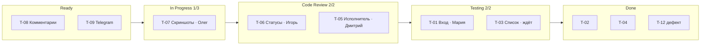

# Kanban-доска: трекер багов студии

## Легенда колонок

| Колонка | WIP-лимит | Что значит |
|---------|-----------|------------|
| Backlog | — | все задачи, которые ещё не готовы к работе |
| Ready | 4 | задача описана, есть критерии приёмки, можно брать |
| In Progress | 3 | кто-то пишет код |
| Code Review | 2 | код ждёт или проходит ревью (ревьюит не автор) |
| Testing | 2 | Мария (или другой член команды) проверяет на тестовом сервере |
| Done | — | выложено в релиз |
| Expedite | 1 | отдельная дорожка сверху только для Critical-дефектов |

Правила:

1. Карточку **вытягивают** из колонки слева, а не «назначают сверху».
2. Если колонка заполнена по WIP-лимиту, новую карточку туда не кладём. Сначала помогаем закончить то, что уже там.
3. Карточку из Expedite берут первой, как только у кого-то освободились руки.
4. Формат карточки: `ID | название | SP | исполнитель | день, когда начали`.

## Срез доски на 6-й день

```
+-----------+-------------+---------------+---------------+---------------+------------+
| Backlog   | Ready (4)   | In Progress(3)| Code Review(2)| Testing (2)   | Done       |
+===========+=============+===============+===============+===============+============+
| EXPEDITE (1):  пусто  (T-12 уже в Done, исправлен на 5-й день)                       |
+-----------+-------------+---------------+---------------+---------------+------------+
| T-10      | T-08 3sp    | T-07 5sp      | T-06 5sp      | T-01 5sp      | T-02       |
| T-11      | T-09 5sp    |  Олег, д.5    |  Игорь, д.3   |  Мария, д.5   | T-04       |
|           |             |               | T-05 2sp      | T-03 3sp      | T-12       |
|           |             |               |  Дмитрий, д.4 |  ждёт Марию   |            |
+-----------+-------------+---------------+---------------+---------------+------------+
  занято:      2/4           1/3             2/2 (полно)     2/2 (полно)
```

То же самое в виде mermaid-схемы:



## Что видно по срезу (узкие места)

- **Testing забит (2/2), и T-03 просто ждёт.** Тестирует одна Мария, поэтому это главное узкое место.
- **Code Review тоже забит (2/2).** Игорь закончил T-06 и хочет взять новую задачу, но по правилу 2 в In Progress её не возьмёт, пока ревью и тестирование стоят.
- In Progress занят только на 1/3, то есть разработчики **простаивают не из-за нехватки задач, а из-за потока**. В Scrum это было бы видно только в конце спринта по burndown, а на Kanban-доске видно сразу.

Что делаем:

1. Игорь не берёт новую карточку, а делает ревью T-05. Освобождается место в Code Review.
2. Олег по правилу коллективного владения (XP) помогает Марии: проверяет T-03 по чек-листу.
3. На следующей неделе Анна предлагает обсудить: может, Testing держать с WIP 3, а Марии написать автотесты на типовые проверки (это связано с TDD).

## Как выглядел бы этот же день в Scrum

В спринте 1 только T-01, T-02, T-03, T-04 и T-06. На 6-й день на доске спринта были бы те же T-01, T-03, T-06 в работе, но **T-12 ещё лежал бы в Product Backlog** до спринта 2. Карточек T-05 и T-07 на доске не было бы вовсе: они не входят в спринт 1.
