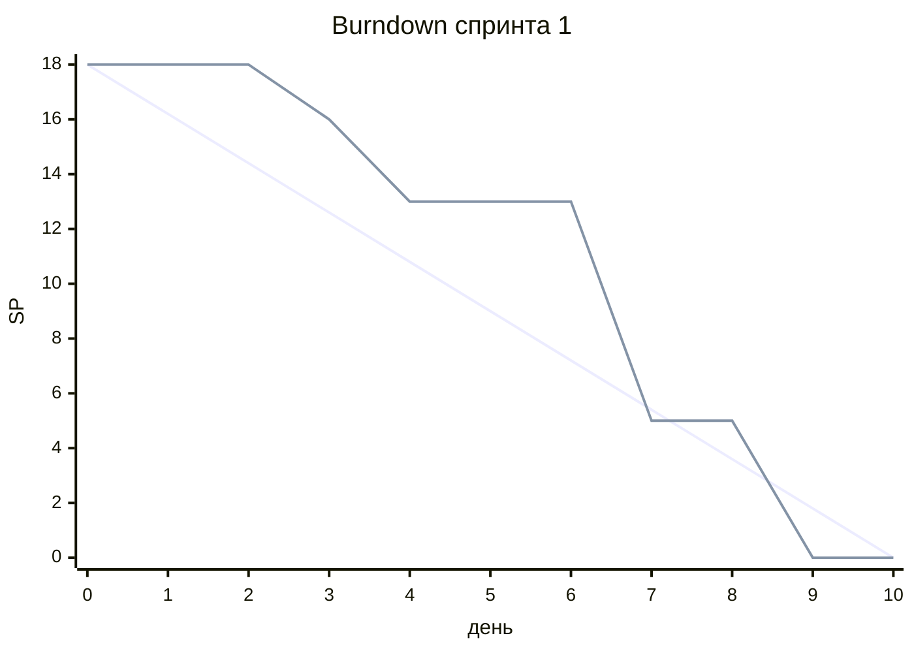

# Burndown спринта 1

Цель: «Баг можно завести и довести до закрытия». Задачи T-01, T-02, T-03, T-04, T-06, всего 18 SP, 10 рабочих дней.

Идеальная линия — равномерное сгорание: 18 / 10 = 1,8 SP в день.

| День | Идеально, SP | Факт, SP | Что закрыли |
|------|--------------|----------|-------------|
| 0 | 18.0 | 18 | — |
| 1 | 16.2 | 18 | — |
| 2 | 14.4 | 18 | — |
| 3 | 12.6 | 16 | T-04 (2) |
| 4 | 10.8 | 13 | T-02 (3); найден дефект T-12, ушёл в Product Backlog |
| 5 | 9.0 | 13 | — |
| 6 | 7.2 | 13 | — (затор на тестировании) |
| 7 | 5.4 | 5 | T-01 (5), T-03 (3) |
| 8 | 3.6 | 5 | — |
| 9 | 1.8 | 0 | T-06 (5) |
| 10 | 0.0 | 0 | Sprint Review |

Первая линия — идеальная, вторая — факт.

Вывод: с 1-го по 6-й день факт выше идеальной линии, потому что задачи застряли на тестировании. Это же узкое место видно на Kanban-доске (`board.md`). Спринт всё равно закрыли вовремя.
