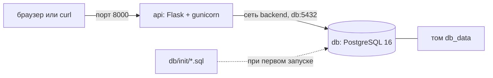

# Задача 19: Трекер багов студии

**Студент:** Ленец Е.

**Постановка.** API задач + PostgreSQL. Compose: `api` и `db`. Создать баг, сменить статус, фильтр по приоритету. SQL-дамп/seed на 5–10 записей при первом запуске.

## Что в репозитории

| Файл | Что это |
|------|---------|
| `app/main.py` | API на Flask |
| `app/requirements.txt` | зависимости приложения |
| `Dockerfile` | сборка образа API |
| `compose.yaml` | два сервиса: `api` и `db` |
| `.env.example` | пример переменных окружения |
| `db/init/01_schema.sql` | таблица `bugs` |
| `db/init/02_seed.sql` | 8 начальных багов |

## Как это устроено



- **`db`** — готовый официальный образ `postgres:16`. Данные лежат в именованном томе `db_data`, поэтому не пропадают при перезапуске. Порт базы наружу не открыт, к ней ходит только `api` по внутренней сети `backend`.
- **`api`** — свой образ из `Dockerfile` на базе `python:3.12-slim`. Приложение запускается через gunicorn от обычного пользователя, не от root.
- **Порядок старта.** У `db` есть healthcheck (`pg_isready`). У `api` указано `depends_on: db: condition: service_healthy`, поэтому API стартует только когда база уже принимает подключения, а не просто когда контейнер запущен.
- **Seed.** Папка `db/init` подключена в `/docker-entrypoint-initdb.d`. Postgres сам выполняет скрипты оттуда по алфавиту, но только если том с данными пустой, то есть при первом запуске.
- **Healthcheck API** описан в `Dockerfile`: раз в 10 секунд запрашивается `/health`, а он делает `SELECT 1` в базу.
- **Пароль** не хранится в коде и в репозитории: он берётся из файла `.env`, который добавлен в `.gitignore`.

## Запуск

Нужен Docker с Docker Compose.

```bash
git clone https://github.com/qqZeR002/lab7-docker-compose.git
cd lab7-docker-compose
cp .env.example .env
docker compose up --build -d
```

Посмотреть состояние (у обоих контейнеров должно быть `healthy`):

```bash
docker compose ps
```

```
bugtracker-api   Up 22 seconds (healthy)
bugtracker-db    Up 27 seconds (healthy)
```

Если порт 8000 занят, поменяйте `API_PORT` в `.env`.

## Проверка

### API

| Метод и путь | Что делает |
|--------------|------------|
| `GET /health` | API и база живы |
| `GET /bugs` | список багов, фильтры `?priority=` и `?status=` |
| `GET /bugs/{id}` | один баг |
| `POST /bugs` | создать баг |
| `PATCH /bugs/{id}/status` | сменить статус |

Приоритеты: `critical`, `high`, `medium`, `low`. Статусы: `open`, `in_progress`, `fixed`, `verified`, `closed`.

### 1. Сервис жив, seed загрузился

```bash
curl http://localhost:8000/health
```

```json
{"db":"ok","status":"ok"}
```

```bash
curl http://localhost:8000/bugs
```

Вернётся 8 багов из `02_seed.sql`.

### 2. Создать баг

```bash
curl -X POST http://localhost:8000/bugs \
  -H "Content-Type: application/json" \
  -d '{"title": "Не работает кнопка «Назад» в настройках", "priority": "high"}'
```

Ответ с кодом 201:

```json
{"id":9,"title":"Не работает кнопка «Назад» в настройках","description":"","priority":"high","status":"open","created_at":"...","updated_at":"..."}
```

### 3. Сменить статус

```bash
curl -X PATCH http://localhost:8000/bugs/9/status \
  -H "Content-Type: application/json" \
  -d '{"status": "in_progress"}'
```

В ответе `"status":"in_progress"`.

### 4. Фильтр по приоритету

```bash
curl "http://localhost:8000/bugs?priority=critical"
```

Вернутся два бага: `id` 1 и 2. Фильтры можно совмещать: `/bugs?priority=high&status=in_progress`.

### 5. Ошибки

| Запрос | Ответ |
|--------|-------|
| `POST /bugs` без `title` | 400 `поле title обязательно` |
| `GET /bugs?priority=urgent` | 400 и список допустимых значений |
| `PATCH /bugs/999/status` | 404 `баг не найден` |

### 6. Данные сохраняются после перезапуска

```bash
docker compose down
docker compose up -d
curl http://localhost:8000/bugs
```

Багов по-прежнему 9, seed второй раз не выполняется.

## Остановка

```bash
docker compose down        # остановить, данные останутся в томе
docker compose down -v     # остановить и удалить том, при следующем запуске seed выполнится заново
```

Логи: `docker compose logs api` и `docker compose logs db`.
