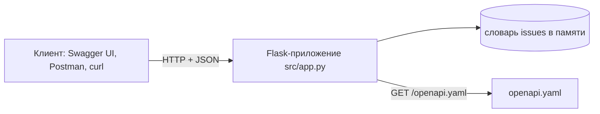

# Техническая документация

## 1. Архитектура



Сервис — одно Flask-приложение. Сейчас это stub: баги лежат в словаре `issues` в памяти процесса. Источник правды по API — файл `openapi.yaml`, сервер отдаёт его же по адресу `/openapi.yaml`, а страница `/docs` показывает его через Swagger UI.

Что нужно будет заменить для настоящей версии: словарь `issues` на таблицу в PostgreSQL. Пути и форматы ответов при этом не поменяются.

## 2. Структура репозитория

```
.
├── README.md             обзор и ссылки на документы
├── openapi.yaml          спецификация API (OpenAPI 3.0.3)
├── docs/
│   ├── user.md           руководство пользователя
│   └── tech.md           этот файл
└── src/
    ├── app.py            stub API и Swagger UI
    └── requirements.txt  зависимости (только flask)
```

## 3. Как запустить

Нужен Python 3.10 или новее.

```bash
python3 -m venv .venv
source .venv/bin/activate        # Windows: .venv\Scripts\activate
pip install -r src/requirements.txt
python src/app.py
```

Проверка:

```bash
curl http://127.0.0.1:8000/issues
```

Должен вернуться список из трёх багов-примеров. Swagger UI: http://127.0.0.1:8000/docs (для него нужен интернет, интерфейс загружается с CDN unpkg.com).

### Переменные окружения

| Переменная | По умолчанию | Зачем |
|-----------|--------------|-------|
| `HOST` | `127.0.0.1` | адрес, на котором слушает сервер. `0.0.0.0` — чтобы открыть доступ из локальной сети |
| `PORT` | `8000` | порт |

Пример: `PORT=8080 python src/app.py`. Секретов и файла `.env` у проекта нет.

## 4. Ключевые модули

Весь код в `src/app.py`:

| Часть | Что делает |
|-------|-----------|
| `PRIORITIES`, `STATUSES` | списки допустимых значений; должны совпадать с `enum` в `openapi.yaml` |
| `TRANSITIONS` | словарь «из какого статуса в какой можно перейти» |
| `read_issue_fields()` | проверка тела запроса для `POST` и `PUT`, возвращает поля или текст ошибки |
| `add_issue()` | создаёт баг, выдаёт `id`, ставит время создания |
| `list_issues()` … `change_status()` | обработчики шести операций API |
| `spec()`, `docs()` | отдают `openapi.yaml` и страницу Swagger UI |

Соответствие операций и кода:

| Операция в `openapi.yaml` (`operationId`) | Путь | Функция |
|------------------------------------------|------|---------|
| `listIssues` | `GET /issues` | `list_issues` |
| `createIssue` | `POST /issues` | `create_issue` |
| `getIssue` | `GET /issues/{issueId}` | `get_issue` |
| `updateIssue` | `PUT /issues/{issueId}` | `update_issue` |
| `deleteIssue` | `DELETE /issues/{issueId}` | `delete_issue` |
| `changeIssueStatus` | `PATCH /issues/{issueId}/status` | `change_status` |

## 5. Приоритеты и Definition of Done бага

### Приоритеты

| Приоритет | Когда ставить | Срок реакции (взять в работу) | Пример |
|-----------|---------------|-------------------------------|--------|
| `critical` | игра не запускается, вылетает, теряются данные или деньги игрока | в тот же рабочий день | вылет при открытии магазина |
| `high` | основная функция работает неправильно, обхода нет | 2 рабочих дня | не начисляются монеты за рекламу |
| `medium` | функция работает с ошибкой, но есть обход | в текущем спринте | текст кнопки вылезает за края |
| `low` | косметика, опечатки | когда есть время | опечатка в описании уровня |

Приоритет ставит тот, кто завёл баг. Руководитель студии может его поменять через `PUT /issues/{issueId}`.

### Definition of Done (DoD) бага

DoD — это список условий, при которых баг считается сделанным. Он привязан к статусам: в следующий статус баг переводят только когда выполнены условия.

| Переход | Условия |
|---------|---------|
| `open → in_progress` | у бага есть исполнитель (`assignee`); в описании есть шаги воспроизведения и версия игры |
| `in_progress → fixed` | причина найдена и исправлена; на эту ошибку написан автотест; код прошёл ревью |
| `fixed → verified` | тестировщик повторил шаги из описания на тестовой сборке, баг не воспроизводится; соседние функции не сломались |
| `verified → closed` | исправление вышло в релизе; для `critical` в описание добавлена причина ошибки |

Баг **сделан** (Done), когда он в статусе `closed` и выполнены все условия выше. Если на шаге проверки баг воспроизвёлся, его возвращают `fixed → in_progress`.

Как приоритет влияет на DoD: для `critical` и `high` автотест обязателен, для `low` (опечатки, картинки) его можно не писать.

Сервер проверяет только порядок переходов (словарь `TRANSITIONS`, ответ `409` при нарушении). Остальные условия DoD — договорённость команды, код их не проверяет.

## 6. Договорённости

- **Формат.** Запросы и ответы в JSON, кодировка UTF-8. Имена полей на английском в `snake_case`.
- **Время.** Поля `created_at` и `updated_at` в формате ISO 8601, в UTC.
- **Ошибки.** Всегда объект с одним полем: `{"error": "текст"}`. Коды: `400` — ошибка в запросе, `404` — бага нет, `409` — запрещённый переход статуса.
- **Статус меняется только через** `PATCH /issues/{issueId}/status`. `PUT` статус не трогает, чтобы нельзя было обойти порядок переходов.
- **Сначала спецификация.** Если меняется API, сначала правится `openapi.yaml`, потом код. После правки спецификацию надо проверить:

```bash
pip install openapi-spec-validator
openapi-spec-validator openapi.yaml
```

## 7. Ограничения текущей версии

- данные в памяти, после перезапуска остаются только три бага-примера;
- нет входа по логину и разделения прав;
- нет постраничной выдачи в `GET /issues`;
- встроенный сервер Flask подходит только для разработки.
