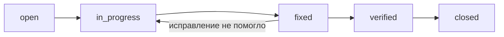

# Руководство пользователя

Для тех, кто работает с трекером: тестировщики, разработчики, руководитель студии. Читать исходный код для этого не нужно.

## 1. Доступ

Трекер работает как веб-сервис. Адрес по умолчанию: `http://127.0.0.1:8000`.

Запросы можно отправлять тремя способами:

| Способ | Кому удобно |
|--------|-------------|
| страница `http://127.0.0.1:8000/docs` (Swagger UI) | всем, ничего ставить не надо: выбрали операцию, нажали **Try it out**, заполнили поля, нажали **Execute** |
| Postman | тестировщикам |
| `curl` в терминале | разработчикам |

Примеры ниже даны для `curl`, в Swagger UI те же поля заполняются в форме.

Если страница не открывается, сервис не запущен. Как запустить, написано в [технической документации](tech.md#3-как-запустить).

## 2. Что такое баг в трекере

| Поле | Что писать | Пример |
|------|-----------|--------|
| `title` | коротко, что сломалось (обязательно, до 200 символов) | Игра вылетает при открытии магазина |
| `description` | шаги воспроизведения, версия игры, устройство | Android 14, версия 1.4.2. Нажать на иконку магазина. |
| `priority` | насколько срочно: `critical`, `high`, `medium`, `low` | `critical` |
| `assignee` | логин того, кто чинит; можно не указывать | `igor` |
| `status` | на каком этапе баг, ставится трекером | `open` |

Как выбрать приоритет, описано в [технической документации](tech.md#5-приоритеты-и-definition-of-done-бага).

## 3. Основные сценарии

### 3.1 Завести баг

```bash
curl -X POST http://127.0.0.1:8000/issues \
  -H "Content-Type: application/json" \
  -d '{"title": "Игра вылетает при открытии магазина", "description": "Android 14, версия 1.4.2", "priority": "critical", "assignee": "igor"}'
```

В ответе придёт баг с номером `id` и статусом `open`. Номер запомните: по нему баг потом ищут и меняют.

Если не указать `priority`, поставится `medium`.

### 3.2 Сменить статус

Баг проходит статусы по порядку:



| Статус | Что значит | Кто обычно переводит |
|--------|-----------|----------------------|
| `open` | баг заведён, им никто не занимается | — |
| `in_progress` | разработчик взял в работу | разработчик |
| `fixed` | исправление готово | разработчик |
| `verified` | тестировщик проверил, что бага больше нет | тестировщик |
| `closed` | исправление вышло в релизе | руководитель |

Взять баг №1 в работу:

```bash
curl -X PATCH http://127.0.0.1:8000/issues/1/status \
  -H "Content-Type: application/json" \
  -d '{"status": "in_progress"}'
```

Перескакивать через статусы нельзя. Например, из `open` сразу в `closed` трекер не пустит: баг нельзя закрыть без исправления и проверки.

### 3.3 Найти баги по фильтрам

Все баги:

```bash
curl http://127.0.0.1:8000/issues
```

Только критичные:

```bash
curl "http://127.0.0.1:8000/issues?priority=critical"
```

Только те, что ждут проверки тестировщиком:

```bash
curl "http://127.0.0.1:8000/issues?status=fixed"
```

Фильтры можно совместить. Критичные баги, которые ещё никто не взял:

```bash
curl "http://127.0.0.1:8000/issues?priority=critical&status=open"
```

Если ничего не нашлось, придёт пустой список `[]`. Это не ошибка.

### 3.4 Исправить описание или приоритет

```bash
curl -X PUT http://127.0.0.1:8000/issues/1 \
  -H "Content-Type: application/json" \
  -d '{"title": "Игра вылетает при открытии магазина", "description": "Android 14 и 13, версия 1.4.2", "priority": "high", "assignee": "igor"}'
```

Передавать нужно все поля, а не только изменённое. Поле, которое не передали, сбросится в значение по умолчанию.

### 3.5 Удалить баг

```bash
curl -X DELETE http://127.0.0.1:8000/issues/3
```

Удаляйте только баги, заведённые по ошибке (например, дубль). Исправленные баги не удаляют, а доводят до `closed`, иначе пропадёт история.

## 4. Типичные ошибки

| Что видите | Почему | Что делать |
|-----------|--------|-----------|
| `400` `поле title обязательно` | не передан заголовок или он пустой | добавить `title` |
| `400` `priority должен быть одним из: ...` | опечатка в приоритете, например `urgent` | использовать `critical`, `high`, `medium` или `low` |
| `400` `status должен быть одним из: ...` | неизвестный статус в фильтре или при смене | использовать статус из таблицы выше |
| `404` `баг не найден` | бага с таким номером нет или его удалили | проверить номер через `GET /issues` |
| `409` `нельзя перейти из open в closed` | попытка перескочить через статус | переводить по порядку, см. схему |
| `400` `нужен JSON` | забыли заголовок `Content-Type: application/json` или в теле не JSON | добавить заголовок, проверить кавычки |

## 5. FAQ

**Можно ли вернуть баг в работу после `fixed`?**
Да. Если тестировщик видит, что баг остался, он переводит его из `fixed` обратно в `in_progress`.

**Можно ли открыть закрытый баг заново?**
Нет. Из `closed` переходов нет. Если проблема вернулась, заведите новый баг и в описании укажите номер старого.

**Куда делись баги после перезапуска сервиса?**
Текущая версия — заглушка (stub), она хранит данные в памяти. После перезапуска остаются только три бага-примера.

**Кто может менять статус?**
Сейчас любой, кто имеет доступ к сервису: входа по логину в этой версии нет.
